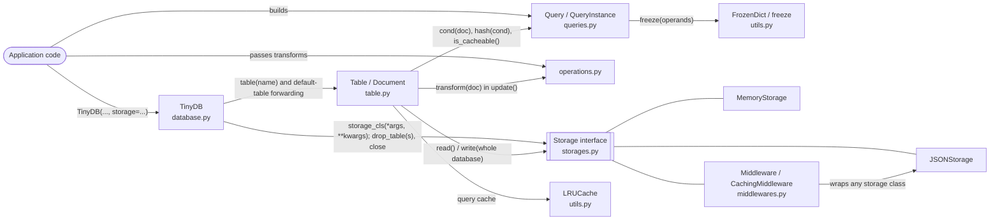

# TinyDB architecture

This document describes TinyDB 4.9.0 as it exists in this repository. TinyDB is a small,
document-oriented database written in pure Python; its runtime uses only the standard
library. All data lives in one nested dict: table name → document ID → document.
File references are `path:line` and point at the code where each statement can be seen.

## 1. Overview

### Components

| Component | Module | Responsibility |
|---|---|---|
| Package façade | `tinydb/__init__.py` | Re-exports `TinyDB`, `Query`, `where`, `Storage`, `JSONStorage` (`__init__.py:28-33`). |
| Database | `tinydb/database.py` | `TinyDB` creates the storage from a storage *class* plus the constructor arguments (`database.py:87-98`), creates one `Table` per name and keeps it in `self._tables` (`database.py:111-133`), forwards unknown attributes and `len()`/`iter()` to the default table `_default` (`database.py:251-274`), drops tables and closes the storage. |
| Tables & documents | `tinydb/table.py` | `Table` implements every document operation (insert, search, get, update, upsert, remove, truncate, count), allocates document IDs (`table.py:744-777`), owns the per-table query cache (`table.py:41-50`) and performs every table write through `_update_table()` (`table.py:804-854`). `Document` is a `dict` subclass that carries `doc_id` (`table.py:22-32`). |
| Query language | `tinydb/queries.py` | `Query` is a builder: attribute/item access extends a field path (`queries.py:193-216`) and operators create `QueryInstance` objects. A `QueryInstance` is a callable predicate over a plain `Mapping` with a hash value that identifies it (`queries.py:59-138`). `where(key)` is shorthand for `Query()[key]`. |
| Storages | `tinydb/storages.py` | `Storage` is the abstract persistence interface (`storages.py:36-76`). `JSONStorage` keeps the database in a JSON file (`storages.py:79-161`); `MemoryStorage` keeps it in a Python attribute (`storages.py:164-181`). |
| Middlewares | `tinydb/middlewares.py` | `Middleware` wraps a storage class and looks like a storage to TinyDB (`middlewares.py:10-73`). `CachingMiddleware` buffers writes in memory (`middlewares.py:76-142`). |
| Update operations | `tinydb/operations.py` | Factories (`delete`, `add`, `subtract`, `set`, `increment`, `decrement`) that return a `transform(doc)` function which mutates a document in place; `Table.update` calls it (`operations.py:16-75`, `table.py:448-452`). |
| Utilities | `tinydb/utils.py`, `tinydb/mypy_plugin.py` | `LRUCache` for the query cache (`utils.py:43-117`), `FrozenDict`/`freeze` to make query operands hashable (`utils.py:120-169`), `with_typehint` plus a mypy plugin so `TinyDB` type-checks like a `Table` (`utils.py:21-40`). |

### Who calls whom

### Main flows

*Write.* `db.insert(doc)` reaches the default table through `TinyDB.__getattr__`.
`Table.insert` picks an ID with `_get_next_id()` and calls `_update_table(updater)`, which
reads the whole database from the storage, converts the table's keys to `int`
(`table.py:834-837`), lets `updater` change the table dict, converts the keys back to `str`
(`table.py:845-848`), writes the whole database back (`table.py:851`) and clears the
table's query cache (`table.py:854`). `update`, `upsert`, `remove`, `truncate` and
`insert_multiple` follow the same path.

*Read.* `Table.search(q)` first looks `q` up in the query cache (`table.py:265-267`). On a
miss it evaluates `q(doc)` for every stored document, wraps the matches as `Document`
objects and stores a copy of the list in the cache if `q.is_cacheable()`
(`table.py:272-297`). `get`, `contains` and `__iter__` read the table directly without
the cache.

*Imports.* `__init__` imports `queries`, `storages` and `database`; `database` imports the
package façade, `storages`, `table` and `utils`; `table` imports `queries` (only the
`QueryLike` protocol), `storages` and `utils`; `queries` imports `utils`; `middlewares`
imports `Storage` from the package; `storages`, `operations` and `utils` import only the
standard library.

## 2. Architecture decisions

### ADR-1: The storage interface reads and writes the whole database

**Status:** Verified (docstrings at `storages.py:36-69` and `table.py:808-812`; return
`None` for an empty storage was settled in upstream issue #67). Alternatives: Inferred.

**Context.** TinyDB is meant for small applications and must persist to a JSON file, to
memory and to formats written by users.

**Decision.** A storage is a class with `read()`, which returns the complete database dict
or `None` when nothing has been stored yet, and `write(data)`, which replaces the complete
database; `close()` is optional (`storages.py:47-76`). `TinyDB` receives the storage
*class* and instantiates it with all of its own constructor arguments except `storage`
(`database.py:92-95`). Tables modify data by read-modify-write of that whole dict
(`table.py:804-854`).

**Alternatives considered.** A per-document key/value interface (`get`/`put`/`delete` by
ID) that would allow incremental writes and indexes; passing a ready-made storage
instance to `TinyDB`; a fixed JSON file with no storage abstraction.

**Consequences.** A new backend needs two methods, and middlewares can wrap any backend.
Every write serialises the entire database (`JSONStorage` also `fsync`s,
`storages.py:142-161`), so TinyDB only suits small data sets. The dict returned by
`read()` can be the storage's live state: `MemoryStorage.read()` returns the stored object
itself (`storages.py:177-178`) and so does `CachingMiddleware.read()` (`middlewares.py:97-106`),
while `JSONStorage` parses a fresh copy. With those storages an in-place change to a
document is visible immediately, even if the following `write()` never happens.
Document IDs are strings at rest and `document_id_class` (`int`) in memory.

### ADR-2: Cross-cutting storage behaviour is added with middlewares

**Status:** Verified (docstrings at `middlewares.py:10-19` and `middlewares.py:25-61`;
upstream commit 18d73a1 (#634) for closed-state handling; `ConcurrencyMiddleware` was
removed in 2.0 over an insecure implementation, issue #18). Alternatives: Inferred.

**Context.** Users want caching, logging and similar behaviour around any storage,
without writing one storage class per combination.

**Decision.** `Middleware(StorageClass)` is an object that TinyDB calls as if it were a
storage class: `__call__` instantiates the wrapped class with TinyDB's arguments and
returns the middleware (`middlewares.py:25-65`); unknown attributes are forwarded to the
wrapped storage (`middlewares.py:67-73`). Middlewares can be nested.
`CachingMiddleware` serves reads from memory and writes to the wrapped storage only after
`WRITE_CACHE_SIZE` (1000) writes, on `flush()` or on `close()` (`middlewares.py:86-142`).

**Alternatives considered.** Subclassing each storage (e.g. a caching JSON storage);
building caching into `TinyDB` or `Table`; feature flags on each storage.

**Consequences.** Behaviour composes orthogonally, e.g.
`TinyDB(path, storage=CachingMiddleware(JSONStorage))`. Data written through
`CachingMiddleware` is persisted only on flush/close, and reads or writes after `close()`
raise `ValueError` (`middlewares.py:97-110`). Its `read()` hands out the cached dict
itself (see ADR-1).

### ADR-3: Each table caches query results, keyed by the query object

**Status:** Verified (docstring `table.py:41-50`; comments `table.py:278-295`; protocol
`queries.py:35-56`; flags added to the hash in upstream issue #637 /
`queries.py:358-360`; result sharing documented in #617, `table.py:253-257`). The
alternative SmartCacheTable is also Verified: it was moved out of the core into the
`tinydb-smartcache` package in 3.0.

**Context.** A search scans every document, and applications repeat the same searches.

**Decision.** Every `Table` owns an `LRUCache` (default capacity 10, configurable with
`db.table(name, cache_size=...)`, `table.py:92-108`) that maps a query to its result list.
Queries are hashable value objects: each `QueryInstance` carries a `hashval` tuple
(operator, path, frozen operands) and both `__hash__` and `__eq__` are derived from it
(`queries.py:76-112`); `&` and `|` combine hashes in a `frozenset` because they are
commutative, `~` wraps the hash (`queries.py:116-138`). A query whose hash cannot be
stable gets `hashval=None` and `is_cacheable()` returns `False`, e.g. `map()`
(`queries.py:515-529`) or unhashable operands (`queries.py:76-85`). Every write made
through `_update_table()` clears the table's cache (`table.py:853-854`).

**Alternatives considered.** No cache; keying by `repr()` or object identity; a "smart"
cache that patches cached results on every write (SmartCacheTable); caching only at the
storage level (`CachingMiddleware`).

**Consequences.** Repeated searches cost one dictionary lookup. Correctness depends on the
hash: two queries with equal `hashval` are treated as the same query and share one cache
entry. `test()` functions must be deterministic (`queries.py:392-397`). Search results
share `Document` objects with the cache and must be treated as read-only. Invalidation
only happens on writes made through that `Table` object: `TinyDB.drop_tables()` and
`drop_table()` write to the storage directly (`database.py:170`, `database.py:202`), so a
`Table` object obtained before the drop keeps stale cached results; changes made by
another process are not noticed either.

## 3. Constraints

**C1. New storages subclass `Storage`.** They implement `read()`, returning the whole
database dict or `None` when empty, and `write(data)`, replacing the whole database. A
storage that holds resources implements `close()`. *Where:* `tinydb/storages.py:36-76`
(`JSONStorage` and `MemoryStorage` below it are the reference implementations).

**C2. All table writes go through `Table._update_table()`.** It is the only place in
`table.py` that calls `storage.write()` and it clears the query cache afterwards. Table
methods do not write to the storage themselves, and code does not mutate documents
returned by `search()`, `get()` or `all()`. *Where:* `tinydb/table.py:804-854`,
`tinydb/table.py:253-257`.

**C3. A query's hash value captures everything that affects its result.** That means the
operator, the full field path, every operand (made hashable with `utils.freeze`) and
options such as regex flags. If no stable hash is possible, the query is built with
`hashval=None` so that it is never cached. *Where:* `tinydb/queries.py:76-112`
(`QueryInstance`), `tinydb/queries.py:218-252` (`_generate_test`),
`tinydb/queries.py:343-381` (`matches`/`search`).

**C4. `TinyDB(*args, **kwargs)` passes every argument except `storage` to the storage
class.** `JSONStorage` keeps unknown keyword arguments and passes them to `json.dumps` on
every write. An option meant for `TinyDB` itself is removed from `kwargs` before the
storage is constructed; options for tables travel through
`TinyDB.table(name, **kwargs)` to `table_class(storage, name, **kwargs)`. *Where:*
`tinydb/database.py:87-95`, `tinydb/database.py:111-133`, `tinydb/storages.py:84-106`,
`tinydb/storages.py:147`.

**C5. Lower layers do not import higher layers.** `queries.py` imports only `utils`;
`storages.py`, `operations.py` and `utils.py` import nothing from `tinydb`; `table.py`
does not import `database.py`. *Where:* the import blocks at `tinydb/queries.py:19-23`,
`tinydb/storages.py:6-11`, `tinydb/operations.py:12-13`, `tinydb/utils.py:5-7` and
`tinydb/table.py:6-17`.
